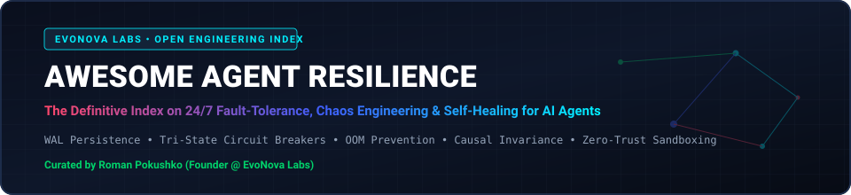

<div align="center">
  
</div>

<br/>

# Awesome Autonomous Agent Resilience [](https://awesome.re)

[](https://creativecommons.org/publicdomain/zero/1.0/)
[](https://github.com/pokushko)
[](https://doi.org/10.5281/zenodo.23942797)
[](CONTRIBUTING.md)

> A rigorously curated index of runtime harnesses, foundational peer-reviewed research, chaos engineering frameworks, and architectural patterns for engineering **24/7 self-healing, memory-bounded, and fault-tolerant autonomous AI agents**.

Curated and maintained by **Roman Pokushko** (Founder & Lead Architect at [EvoNova Labs](https://github.com/pokushko)).

---

## 🧭 The Agent Failure Taxonomy Matrix

Before deploying agents into long-running production environments (days, weeks, continuous marathons), use this engineering matrix to anticipate failure modes and deploy SOTA mitigations:

| Failure Mode | Observable Symptom | Root Cause | SOTA Mitigation | Reference Tool / Paper |
| :--- | :--- | :--- | :--- | :--- |
| **Context Saturation** | Agent ignores early instructions, hallucinates prior tools | *Lost-in-the-Middle* attention degradation over long context (>32k tokens) | Exponential Temporal Memory Decay & Summarization | [Agentic Vector Memory](https://github.com/pokushko/agentic-vector-memory), [Liu et al. (TACL 2024)](https://arxiv.org/abs/2307.03172) |
| **Gateway Dropouts** | Unhandled `HTTP 429 / 502 / 503` crashing background loop | Upstream LLM provider rate limits, network partitions | Tri-State Circuit Breakers (`CLOSED/OPEN/HALF_OPEN`) + Local Fallback | [AgentBunker](https://github.com/pokushko/agent-bunker), [LiteLLM](https://github.com/BerriAI/litellm) |
| **Silent Swarm Delusion** | Multi-agent swarms agree on mathematically false outputs | Lack of adversarial critique; sycophancy in LLM consensus | Hostile Reviewer Simulation & Causal Do-Calculus Invariance | [EvoNova Scientist](https://doi.org/10.5281/zenodo.23942797), [Stanford MAD](https://arxiv.org/abs/2305.14325) |
| **Host Environment Damage** | Accidental file deletion (`rm -rf`), socket binds, dunder escape | Untrusted LLM code interpreter executing arbitrary mutations | Pre-flight Static AST Syntax Inspection & eBPF container isolation | [Agent Security Sandbox](https://github.com/pokushko/agent-security-sandbox), [gVisor](https://github.com/google/gvisor) |
| **Process Sudden Death** | Host machine reboot wipes in-flight reasoning without trace | Ephemeral in-memory agent state without atomic journal | Transactional Write-Ahead Logging (WAL) & Replay Engine | [AgentBunker WAL](https://github.com/pokushko/agent-bunker), [Temporal](https://github.com/temporalio/temporal) |
| **RSS Memory Leaks** | Linux Kernel OOM killer terminates Python agent process | Uncollected vector store caches, unbounded conversation arrays | Process RSS Ceiling Monitor + Proactive Garbage Collection | [MemoryGuard](https://github.com/pokushko/agent-bunker), Linux cgroups v2 |
| **Infinite Tool Recursion** | Agent burns through API quotas repeating identical actions | Semantic feedback loop without reflexivity or failure backoff | Verbal Reinforcement Learning & Heuristic Failure Breakers | [Reflexion (NeurIPS 2023)](https://arxiv.org/abs/2303.11366), [Self-Refine](https://arxiv.org/abs/2303.17651) |

---

## Contents

- [Runtime Harnesses & 24/7 Resilience Frameworks](#runtime-harnesses--247-resilience-frameworks)
- [Foundational Research Papers](#foundational-research-papers)
- [Chaos Engineering & Fault Injection](#chaos-engineering--fault-injection)
- [Memory Management, Context Boundedness & OOM Prevention](#memory-management-context-boundedness--oom-prevention)
- [Sandbox Isolation & Execution Security](#sandbox-isolation--execution-security)
- [Causal Inference & Invariance Verification](#causal-inference--invariance-verification)
- [Multi-Agent Consensus & Hostile Reviewers](#multi-agent-consensus--hostile-reviewers)
- [Benchmarks & Stress-Testing Suites](#benchmarks--stress-testing-suites)
- [Real-World Post-Mortems & Incident Case Studies](#real-world-post-mortems--incident-case-studies)
- [Architectural Patterns for 24/7 Survival](#architectural-patterns-for-247-survival)
- [Contributing](#contributing)

---

## Runtime Harnesses & 24/7 Resilience Frameworks

- [AgentBunker](https://github.com/pokushko/agent-bunker) - Enterprise chaos engineering & 24/7 resilience harness developed by **EvoNova Labs**. Provides atomic Write-Ahead Logging (WAL), RSS memory ceiling monitors, circuit breakers, and network blackout injection.
- [NeMo Guardrails](https://github.com/NVIDIA/NeMo-Guardrails) - NVIDIA's open-source toolkit for adding programmable safety, security, and operational guardrails to LLM applications.
- [LiteLLM](https://github.com/BerriAI/litellm) - High-throughput multi-provider LLM gateway supporting automated fallback cascades, load balancing, exponential backoff, and cooldown periods.
- [LangGraph](https://github.com/langchain-ai/langgraph) - Cyclic state-machine agent framework with built-in persistence, human-in-the-loop pause/resume, and time-travel rollbacks.
- [Temporal](https://github.com/temporalio/temporal) - Durable execution platform ensuring that distributed code workflows execute reliably regardless of server crashes or network partitions.
- [Restate](https://github.com/restatedev/restate) - Resilient execution engine for distributed stateful workflows with zero-downtime event-driven recovery.
- [DBOS](https://github.com/dbos-inc/dbos-transact-py) - Database-Oriented Operating System guaranteeing that all agent states and side effects are transactionally stored in PostgreSQL.
- [Semantic Kernel](https://github.com/microsoft/semantic-kernel) - Microsoft's enterprise orchestrator with native telemetry, retry policies, and structured plugin filters.

---

## Foundational Research Papers

### Self-Healing & Reflexive Loops
- **Reflexion: Language Agents with Verbal Reinforcement Learning** (Shinn et al., NeurIPS 2023) - Demonstrates how autonomous agents evaluate their own execution failures and record verbal self-reflections to self-heal in future turns. [arXiv:2303.11366](https://arxiv.org/abs/2303.11366)
- **Self-Refine: Iterative Refinement with Self-Feedback** (Madaan et al., NeurIPS 2023) - Framework for autonomous multi-step output verification and deterministic self-correction without external ground-truth labels. [arXiv:2303.17651](https://arxiv.org/abs/2303.17651)
- **Toolformer: Language Models Can Teach Themselves to Use Tools** (Schick et al., NeurIPS 2023) - Self-supervised discovery of when and how to call external APIs, gracefully recovering from failed external invocations. [arXiv:2302.04761](https://arxiv.org/abs/2302.04761)
- **EvoNova Scientist: A Neuro-Symbolic Multi-Agent Framework for Physical Constraint-Preserving Autonomous Scientific Discovery** (Pokushko & Pokushko, CERN Zenodo 2026) - Analyzes hallucination cascades in autonomous scientific agents (including failure analysis of Sakana AI's *The AI Scientist*) and introduces physical boundary invariant solvers. [DOI: 10.5281/zenodo.23942797](https://doi.org/10.5281/zenodo.23942797)

### Memory, Context & Attention Stability
- **Lost in the Middle: How Language Models Use Long Contexts** (Liu et al., TACL 2024) - Analyzes severe performance degradation as input context scales, proving the necessity of bounded episodic memory and context pruning. [arXiv:2307.03172](https://arxiv.org/abs/2307.03172)
- **MemGPT: Towards LLMs as Operating Systems** (Packer et al., 2023) - Treats LLM memory like OS virtual memory (RAM vs Disk paging), managing bounded context via automated episodic paging. [arXiv:2310.08560](https://arxiv.org/abs/2310.08560)
- **A-MEM: Agentic Memory with Adaptive Decay & Retrieval** (2024) - Biologically inspired memory architectures combining cosine similarity with exponential recency decay.

---

## Chaos Engineering & Fault Injection

- [Chaos Mesh](https://github.com/chaos-mesh/chaos-mesh) - Cloud-native chaos engineering platform for Kubernetes simulating pod kills, network partitions, and clock skew.
- [Chaos Toolkit](https://github.com/chaostoolkit/chaostoolkit) - Declarative, open-source API for automating chaos experiments and verifying automated recovery hypotheses.
- [Toxiproxy](https://github.com/Shopify/toxiproxy) - TCP proxy for simulating network anomalies (latency, bandwidth limits, peer dropouts) in agent test harnesses.
- [LitmusChaos](https://github.com/litmuschaos/litmus) - Cloud-native Chaos Engineering framework providing cross-cloud fault injection.

---

## Memory Management, Context Boundedness & OOM Prevention

- [agentic-vector-memory](https://github.com/pokushko/agentic-vector-memory) - Dual-store episodic and semantic memory engine developed by **EvoNova Labs** with exponential temporal decay $e^{-\lambda \Delta t}$, access-frequency reinforcement, and SQLite ACID persistence.
- [DuckDB](https://github.com/duckdb/duckdb) - High-performance embedded columnar analytical database ideal for local agent audit trails, episodic logs, and telemetry storage.
- [Qdrant](https://github.com/qdrant/qdrant) - High-throughput vector search engine with payload-based filtering, quantization, and disk-backed HNSW indexing.
- [Chroma](https://github.com/chroma-core/chroma) - Open-source embedding database designed for local developer ergonomics.

---

## Sandbox Isolation & Execution Security

- [agent-security-sandbox](https://github.com/pokushko/agent-security-sandbox) - AST-level static code inspector and execution sanitizer developed by **EvoNova Labs** preventing prompt injections, dangerous OS imports, and dunder escape exploits.
- [gVisor](https://github.com/google/gvisor) - Google's application kernel written in Go that provides a virtualized container boundary for untrusted LLM-generated code execution.
- [Firecracker](https://github.com/firecracker-microvm/firecracker) - Secure, fast microVMs developed by AWS for serverless workloads, providing hardware-level isolation for agent subprocesses in <5ms.
- [eBPF](https://ebpf.io/) - Linux kernel technology enabling real-time syscall interception and execution sandboxing without modifying host application binaries.

---

## Causal Inference & Invariance Verification

- **Causality: Models, Reasoning, and Inference** (Judea Pearl, Cambridge University Press) - The theoretical foundation of Do-Calculus, backdoor criterion adjustment, and causal Directed Acyclic Graphs (DAGs).
- [DoWhy](https://github.com/py-why/dowhy) - Python library for causal inference that formalizes 4-step causal reasoning (Model, Identify, Estimate, Refute) to prevent spurious correlations in agent decisions.
- [EconML](https://github.com/py-why/EconML) - Automated causal machine learning for heterogeneous treatment effect estimation in complex agent policies.

---

## Multi-Agent Consensus & Hostile Reviewers

- [orchestration-engine](https://github.com/pokushko/orchestration-engine) - Lightweight asynchronous orchestration engine developed by **EvoNova Labs** supporting role-based task routing and broadcast consensus.
- [ChatEval](https://github.com/chanchaohen/ChatEval) - Multi-agent debate framework simulating adversarial panel evaluations to eliminate single-agent bias and hallucination.
- [Stanford Multi-Agent Debate (MAD)](https://arxiv.org/abs/2305.14325) - Demonstrates that title-antithesis-synthesis debates among divergent agent personas dramatically increase reasoning accuracy.

---

## Benchmarks & Stress-Testing Suites

- [SWE-bench](https://github.com/swe-bench/SWE-bench) - Evaluates whether language models can resolve end-to-end software engineering GitHub issues in complex real-world codebases.
- [GAIA: General AI Assistants](https://github.com/huggingface/gaia) - Benchmark evaluating multimodal AI agents on complex, multi-modal tasks requiring persistent tool execution.
- [AgentBench](https://github.com/THUDM/AgentBench) - Multi-dimensional benchmark for evaluating LLMs as agents across 8 distinct operating environments (OS, DB, Web, Knowledge).
- [ToolBench](https://github.com/OpenBMB/ToolBench) - Comprehensive evaluation of tool-use capabilities across 16,000+ real-world REST APIs.

---

## Real-World Post-Mortems & Incident Case Studies

- **The $10,000 Infinite Loop Incident (2023):** An autonomous researcher agent stuck in an unhandled 404 response recursively generated search variants, exhausting cloud credits in 4 hours due to absence of an execution circuit breaker.
- **The Accidental Host File Wipe (2024):** A code generator agent attempting to clean a build directory emitted `os.system("rm -rf " + target)` where `target` was an empty string, triggering recursive root deletion. *Mitigation: Mandatory AST-level static node validation.*
- **Context Window Drift in Trading Fleets (2025):** An unconstrained agent accumulated 200,000 tokens of market noise over 72 hours, resulting in complete hallucination of historical prices due to attention degradation (*Lost-in-the-Middle*). *Mitigation: Exponential decay compaction & bounded episodic store.*

---

## Architectural Patterns for 24/7 Survival

### 1. Write-Ahead Logging (WAL) for LLM Reasoning
Never execute multi-step agent actions without committing intent to disk first. If the host machine reboots midway through a turn, the WAL ensures atomic replay or safe rollback:

```
[User Task] ➡️ [WAL Intent: 'Start Step 1'] ➡️ [Tool Execution] ➡️ [WAL Status: 'Success']
```

### 2. Tri-State Circuit Breaker Pattern
Protect agents from cascading thread starvation when upstream LLM APIs or search tools fail:
- **CLOSED:** Normal operations; requests route to the primary API.
- **OPEN:** After $N$ consecutive 503/429 errors, instantly route all calls to a local safe heuristic/offline cache without waiting for timeouts.
- **HALF-OPEN:** Periodically send a single canary probe to test upstream recovery.

### 3. Vectorized Peak Drawdown / Failure Braking
Vectorized threshold accumulation to halt tool invocations when failure rates breach safety ceilings ($S_{\text{fail}} > \theta$), preventing unmonitored financial or operational damage.

---

## 🤝 Contributing

We welcome community contributions! Please read our [CONTRIBUTING.md](CONTRIBUTING.md) guide before opening a Pull Request.

---

## 📄 License

[](https://creativecommons.org/publicdomain/zero/1.0/)

Dedicated to the public domain under the Creative Commons CC0 1.0 Universal License.
