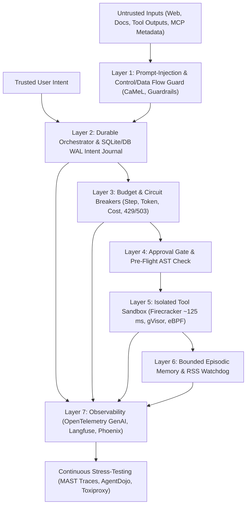

# Agent Failure Taxonomy Matrix & Reference Mitigation Patterns

Long-running autonomous AI agents (running continuously for hours, days, or multi-step production pipelines) fail differently from stateless request-response LLM wrappers. Small prompt or environment anomalies compound over multi-turn trajectories, exhausting budgets, corrupting external state, or causing silent hallucinations.

This reference maps **10 production failure modes (`F01`–`F10`)** directly to the empirical **MAST** 14-mode multi-agent failure taxonomy ([Cemri et al., 2025](https://arxiv.org/abs/2503.13657)) and the [OWASP Top 10 for Agentic Applications (2026)](https://genai.owasp.org/resource/owasp-top-10-for-agentic-applications-for-2026/), paired with self-contained Python 3.11+ mitigation blueprints.

---

## Defense-in-Depth Architecture for 24/7 Agents



---

## Master Failure Taxonomy Matrix (`F01`–`F10`)

| ID | Failure Mode | MAST / OWASP Mapping | Observable Symptom | Root Cause | Mitigation Pattern | Reference Tools, Papers & Incidents |
| :--- | :--- | :--- | :--- | :--- | :--- | :--- |
| **F01** | Context Saturation & Attention Decay | MAST Cat 1 (System Design: Context Bottleneck) | Agent drops early system constraints, forgets prior tool results, or repeats solved sub-tasks | *Lost-in-the-Middle* attention dilution past long context horizons and unbounded prompt accumulation | Bounded episodic window + exponential recency decay eviction + out-of-band state persistence | [Lost in the Middle](https://arxiv.org/abs/2307.03172), [Letta](https://github.com/letta-ai/letta), [A-MEM](https://arxiv.org/abs/2502.12110), [Agentic Vector Memory](https://github.com/pokushko/agentic-vector-memory) |
| **F02** | Upstream Gateway Dropouts & Rate-Limit Storms | Infrastructure & Provider Resilience | Background worker crashes on unhandled HTTP `429 / 502 / 503` or stalls on hanging sockets | Lack of jittered exponential backoff, provider cooldowns, or fallback cascade routing | Tri-state Circuit Breaker (`CLOSED` / `OPEN` / `HALF_OPEN`) + secondary model fallback | [LiteLLM](https://github.com/BerriAI/litellm), [Portkey AI Gateway](https://github.com/Portkey-AI/gateway), [AgentBunker](https://github.com/pokushko/agent-bunker) |
| **F03** | Unbounded Recursion & Runaway Token Spend | MAST Cat 3 (Task Verification & Termination) | Agent repeats identical failing tool calls indefinitely and exhausts token/API quotas | Missing termination predicates, absence of loop-repetition detection, or missing cost ceilings | Hard step counter, cumulative token/USD cap, consecutive-error breaker, and verbal reflection | [Reflexion](https://arxiv.org/abs/2303.11366), [Self-Refine](https://arxiv.org/abs/2303.17651), [Why Do Multi-Agent LLM Systems Fail?](https://arxiv.org/abs/2503.13657) |
| **F04** | Inter-Agent Sycophancy & Cascading Hallucinations | MAST Cat 2 (Inter-Agent Misalignment) | Multi-agent teams quickly agree on physically impossible parameters or invalid code | Uncritical agreement bias between peer LLMs; errors pass downstream without external verification | Adversarial panel debate + deterministic symbolic/formal verifiers (SMT, CAS, dimensional checks) | [Multiagent Debate](https://arxiv.org/abs/2305.14325), [ChatEval](https://github.com/thunlp/ChatEval), [Z3](https://github.com/Z3Prover/z3), [EvoNova Scientist](https://doi.org/10.5281/zenodo.23942797) |
| **F05** | Indirect Prompt Injection & Tool Poisoning | OWASP Agentic / LLM01 (Goal Hijacking) | Agent leaks private emails, files, or tokens when summarizing untrusted docs or calling MCP servers | Control instructions and untrusted external data/metadata share one flat text context | Separate control vs. data flows (capability tags) + pre-scan MCP tool schemas and prompts | [CaMeL](https://arxiv.org/abs/2503.18813), [Snyk Agent-Scan](https://github.com/snyk/agent-scan), [AgentDojo](https://github.com/ethz-spylab/agentdojo), [EchoLeak CVE-2025-32711](https://nvd.nist.gov/vuln/detail/CVE-2025-32711), [Slack AI Exfiltration](https://simonwillison.net/2024/Aug/20/data-exfiltration-from-slack-ai/), [MCP Tool Poisoning](https://invariantlabs.ai/blog/mcp-security-notification-tool-poisoning-attacks) |
| **F06** | Destructive Action / Excessive Agency Without Gate | OWASP Excessive Agency & MAST Cat 1 | Agent executes `DROP TABLE`, overwrites production databases, or ignores natural-language "freeze" instructions | Prompt instructions treated as soft suggestions while agent holds raw write/admin credentials | Capability-scoped least privilege, mandatory human approval on mutating tools, isolated dev/prod environments | [HumanLayer](https://github.com/humanlayer/humanlayer), [12-Factor Agents](https://github.com/humanlayer/12-factor-agents), [Replit / SaaStr DB Deletion Incident (July 2025)](https://www.theregister.com/2025/07/21/replit_saastr_vibe_coding_incident/) |
| **F07** | Process Sudden Death & Ephemeral State Loss | Distributed Workflow Crash Recovery | Host reboot, spot instance preemption, or SIGKILL wipes multi-hour reasoning and causes duplicate side effects | State stored solely in Python RAM (`dict`/`list`) without idempotency keys or durable logs | Durable execution engine or atomic SQLite Write-Ahead Log (WAL) recording intent before side effects | [Temporal](https://github.com/temporalio/temporal), [Restate](https://github.com/restatedev/restate), [DBOS](https://github.com/dbos-inc/dbos-transact-py), [LangGraph](https://github.com/langchain-ai/langgraph) |
| **F08** | RSS Memory Leaks & Kernel OOM Kills | Runtime Resource Boundedness | Linux kernel OOM killer (`SIGKILL`) terminates worker silently after hours of operation | Unbounded in-memory embedding caches, unclosed connections, or uncapped trace buffers | Process RSS ceiling watchdog, proactive GC + compaction, `cgroups v2` caps, disk-backed stores | [DuckDB](https://github.com/duckdb/duckdb), [Qdrant](https://github.com/qdrant/qdrant), [sqlite-vec](https://github.com/asg017/sqlite-vec), [AgentBunker](https://github.com/pokushko/agent-bunker) |
| **F09** | Untrusted Code Execution & Host Escape | Execution Isolation & Host Security | LLM-generated script deletes host files, escapes via Python dunder reflection, or pivots across internal network | Running model-synthesized code in the orchestrator process with `exec()` or bare host shell | Hardware microVMs (~125 ms Firecracker), user-space kernels (gVisor), eBPF policies, and static AST inspection | [E2B](https://github.com/e2b-dev/E2B), [Firecracker](https://github.com/firecracker-microvm/firecracker), [gVisor](https://github.com/gvisor/gvisor), [Cilium Tetragon](https://github.com/cilium/tetragon), [Agent Security Sandbox](https://github.com/pokushko/agent-security-sandbox) |
| **F10** | Policy Hallucination & Unverified External Commitments | MAST Cat 3 (Failure to Detect Errors) | Customer-facing agent invents refund policies, binding discounts, or profanity damaging brand & creating legal liability | Unconstrained free-text generation exposed directly to end users without schema/policy enforcement | Schema-enforced structured outputs, grounded policy retrieval, and automated red-teaming in CI | [Instructor](https://github.com/567-labs/instructor), [Garak](https://github.com/NVIDIA/garak), [Promptfoo](https://github.com/promptfoo/promptfoo), [Moffatt v. Air Canada](https://en.wikipedia.org/wiki/Moffatt_v._Air_Canada), [DPD Incident](https://www.theguardian.com/technology/2024/jan/20/dpd-ai-chatbot-swears-calls-itself-useless-and-criticises-firm), [Chevrolet Watsonville Incident](https://www.businessinsider.com/car-dealership-chevrolet-chatbot-chatgpt-pranks-chevy-2023-12) |

---

## Reference Mitigation Patterns (Python 3.11+)

Each snippet below uses Python's standard library (zero external dependencies) to illustrate the core architectural invariant behind resilient 24/7 agents.

### Pattern 1: Atomic SQLite WAL Intent Journal (Mitigates F07)

Never perform an irreversible external side effect (sending an email, mutating a database, placing an order) without atomically writing an idempotent intent record first.

```python
from __future__ import annotations

import json
import sqlite3
import time
from typing import Any


class AgentWALJournal:
    """Crash-safe intent journal using SQLite Write-Ahead Logging (WAL)."""

    def __init__(self, db_path: str = "agent_wal.sqlite3") -> None:
        self.conn = sqlite3.connect(db_path, isolation_level=None)
        self.conn.execute("PRAGMA journal_mode=WAL;")
        self.conn.execute("PRAGMA synchronous=FULL;")
        self.conn.execute(
            """
            CREATE TABLE IF NOT EXISTS intent_log (
                idempotency_key TEXT PRIMARY KEY,
                step_name       TEXT NOT NULL,
                payload_json    TEXT NOT NULL,
                status          TEXT NOT NULL CHECK (status IN ('PENDING', 'COMMITTED', 'FAILED')),
                updated_at      REAL NOT NULL
            );
            """
        )

    def try_begin(self, key: str, step_name: str, payload: dict[str, Any]) -> bool:
        """Return False if this idempotent step was already committed."""
        row = self.conn.execute(
            "SELECT status FROM intent_log WHERE idempotency_key = ?", (key,)
        ).fetchone()
        if row is not None and row[0] == "COMMITTED":
            return False

        self.conn.execute(
            """
            INSERT INTO intent_log (idempotency_key, step_name, payload_json, status, updated_at)
            VALUES (?, ?, ?, 'PENDING', ?)
            ON CONFLICT(idempotency_key) DO UPDATE SET
                status = 'PENDING',
                updated_at = excluded.updated_at;
            """,
            (key, step_name, json.dumps(payload, sort_keys=True), time.time()),
        )
        return True

    def mark_committed(self, key: str) -> None:
        self.conn.execute(
            "UPDATE intent_log SET status = 'COMMITTED', updated_at = ? WHERE idempotency_key = ?",
            (time.time(), key),
        )

    def mark_failed(self, key: str) -> None:
        self.conn.execute(
            "UPDATE intent_log SET status = 'FAILED', updated_at = ? WHERE idempotency_key = ?",
            (time.time(), key),
        )
```

---

### Pattern 2: Tri-State Circuit Breaker with Recovery Probe (Mitigates F02)

Prevent cascading worker stalls when an upstream LLM provider or tool API degrades.

```python
from __future__ import annotations

import enum
import time
from collections.abc import Callable
from typing import TypeVar

T = TypeVar("T")


class BreakerState(enum.Enum):
    CLOSED = "CLOSED"
    OPEN = "OPEN"
    HALF_OPEN = "HALF_OPEN"


class CircuitOpenError(RuntimeError):
    pass


class TriStateCircuitBreaker:
    """Trips to OPEN on repeated upstream faults and probes in HALF_OPEN after cooldown."""

    def __init__(self, failure_threshold: int = 3, recovery_timeout_s: float = 30.0) -> None:
        self.failure_threshold = failure_threshold
        self.recovery_timeout_s = recovery_timeout_s
        self.state = BreakerState.CLOSED
        self.consecutive_failures = 0
        self.opened_at = 0.0

    def call(self, primary: Callable[[], T], fallback: Callable[[], T] | None = None) -> T:
        now = time.monotonic()
        if self.state is BreakerState.OPEN:
            if now - self.opened_at >= self.recovery_timeout_s:
                self.state = BreakerState.HALF_OPEN
            elif fallback is not None:
                return fallback()
            else:
                raise CircuitOpenError("Upstream circuit breaker is OPEN")

        try:
            result = primary()
        except Exception:
            self.consecutive_failures += 1
            if self.consecutive_failures >= self.failure_threshold or self.state is BreakerState.HALF_OPEN:
                self.state = BreakerState.OPEN
                self.opened_at = now
            if fallback is not None:
                return fallback()
            raise

        self.consecutive_failures = 0
        self.state = BreakerState.CLOSED
        return result
```

---

### Pattern 3: Step, Token & Repetition Budget Breaker (Mitigates F03)

Enforce deterministic termination when an agent enters infinite retries or runaway token consumption (MAST Category 3).

```python
from __future__ import annotations

import hashlib
import json
from dataclasses import dataclass, field


class BudgetExhaustedError(RuntimeError):
    pass


@dataclass
class AgentExecutionBudget:
    max_steps: int = 25
    max_total_tokens: int = 120_000
    max_consecutive_errors: int = 4
    max_identical_tool_calls: int = 3
    steps_used: int = 0
    tokens_used: int = 0
    consecutive_errors: int = 0
    _call_counts: dict[str, int] = field(default_factory=dict)

    def record_step(self, prompt_tokens: int, completion_tokens: int) -> None:
        self.steps_used += 1
        self.tokens_used += prompt_tokens + completion_tokens
        if self.steps_used > self.max_steps:
            raise BudgetExhaustedError(f"Step ceiling exceeded ({self.steps_used}/{self.max_steps})")
        if self.tokens_used > self.max_total_tokens:
            raise BudgetExhaustedError(f"Token ceiling exceeded ({self.tokens_used}/{self.max_total_tokens})")

    def record_tool_call(self, tool_name: str, arguments: dict[str, object], failed: bool) -> None:
        signature = hashlib.sha256(
            f"{tool_name}:{json.dumps(arguments, sort_keys=True, default=str)}".encode()
        ).hexdigest()
        self._call_counts[signature] = self._call_counts.get(signature, 0) + 1

        if self._call_counts[signature] > self.max_identical_tool_calls:
            raise BudgetExhaustedError(f"Repeated identical call loop detected for tool '{tool_name}'")

        self.consecutive_errors = self.consecutive_errors + 1 if failed else 0
        if self.consecutive_errors >= self.max_consecutive_errors:
            raise BudgetExhaustedError(f"Aborted after {self.consecutive_errors} consecutive tool errors")
```

---

### Pattern 4: Control/Data Flow Capability Guard & Approval Gate (Mitigates F05 & F06)

Inspired by CaMeL ([Debenedetti et al., 2025](https://arxiv.org/abs/2503.18813)) and HumanLayer: prevent untrusted content from steering privileged tool invocations, and require explicit human approval for destructive tools.

```python
from __future__ import annotations

from collections.abc import Callable
from dataclasses import dataclass
from typing import Generic, TypeVar

T = TypeVar("T")


@dataclass(frozen=True)
class ProvenanceValue(Generic[T]):
    value: T
    trusted_origin: bool
    source_label: str


class SecurityPolicyViolation(PermissionError):
    pass


def invoke_privileged_tool(
    tool_name: str,
    argument: ProvenanceValue[str],
    *,
    destructive: bool = False,
    human_approver: Callable[[str, str], bool] | None = None,
) -> str:
    """Reject tool calls whose control parameters originate from untrusted external data."""
    if not argument.trusted_origin:
        raise SecurityPolicyViolation(
            f"Blocked untrusted data from '{argument.source_label}' flowing into '{tool_name}'"
        )

    if destructive:
        if human_approver is None or not human_approver(tool_name, argument.value):
            raise SecurityPolicyViolation(
                f"Destructive action '{tool_name}' denied without explicit human approval"
            )

    return f"Executed {tool_name} safely"
```

---

### Pattern 5: Bounded Episodic Decay & Memory Allocation Ceiling (Mitigates F01 & F08)

Evict stale, low-value episodic memories using exponential recency decay before memory growth triggers attention degradation or OOM kills.

```python
from __future__ import annotations

import math
import time
import tracemalloc
from dataclasses import dataclass


@dataclass
class EpisodicEntry:
    entry_id: str
    summary: str
    importance: float
    last_accessed_at: float
    access_count: int = 1


class BoundedEpisodicStore:
    """Caps episodic buffer cardinality via exponential temporal decay."""

    def __init__(self, max_entries: int = 1000, decay_lambda: float = 1e-4) -> None:
        self.max_entries = max_entries
        self.decay_lambda = decay_lambda
        self._entries: dict[str, EpisodicEntry] = {}

    def retention_score(self, entry: EpisodicEntry, now: float) -> float:
        age_seconds = max(0.0, now - entry.last_accessed_at)
        recency = math.exp(-self.decay_lambda * age_seconds)
        reinforcement = math.log1p(entry.access_count)
        return entry.importance * recency + 0.15 * reinforcement

    def put(self, entry: EpisodicEntry) -> None:
        self._entries[entry.entry_id] = entry
        if len(self._entries) > self.max_entries:
            self.compact()

    def compact(self) -> int:
        now = time.time()
        ranked = sorted(
            self._entries.values(),
            key=lambda e: self.retention_score(e, now),
            reverse=True,
        )
        kept = ranked[: self.max_entries]
        evicted = len(self._entries) - len(kept)
        self._entries = {e.entry_id: e for e in kept}
        return evicted

    @staticmethod
    def current_traced_mib() -> float:
        if not tracemalloc.is_tracing():
            return 0.0
        current_bytes, _ = tracemalloc.get_traced_memory()
        return current_bytes / (1024 * 1024)
```

---

### Pattern 6: Pre-Flight AST Security Inspection (Mitigates F09)

Validate LLM-generated Python snippets structurally before dispatching them into an isolated microVM or container sandbox (`Firecracker`, `gVisor`, `E2B`).

```python
from __future__ import annotations

import ast


FORBIDDEN_MODULES = frozenset({"os", "subprocess", "sys", "shutil", "socket", "ctypes", "importlib"})
FORBIDDEN_CALLS = frozenset({"eval", "exec", "compile", "__import__", "open", "getattr", "setattr"})
FORBIDDEN_ATTRS = frozenset({"__class__", "__base__", "__mro__", "__subclasses__", "__globals__", "__builtins__"})


class StaticASTSecurityVisitor(ast.NodeVisitor):
    """Rejects hazardous imports, dynamic code eval, and dunder reflection chains."""

    def __init__(self) -> None:
        self.violations: list[str] = []

    def visit_Import(self, node: ast.Import) -> None:
        for alias in node.names:
            root = alias.name.split(".")[0]
            if root in FORBIDDEN_MODULES:
                self.violations.append(f"Forbidden import '{alias.name}' at line {node.lineno}")
        self.generic_visit(node)

    def visit_ImportFrom(self, node: ast.ImportFrom) -> None:
        root = (node.module or "").split(".")[0]
        if root in FORBIDDEN_MODULES:
            self.violations.append(f"Forbidden import-from '{node.module}' at line {node.lineno}")
        self.generic_visit(node)

    def visit_Call(self, node: ast.Call) -> None:
        if isinstance(node.func, ast.Name) and node.func.id in FORBIDDEN_CALLS:
            self.violations.append(f"Forbidden builtin call '{node.func.id}' at line {node.lineno}")
        self.generic_visit(node)

    def visit_Attribute(self, node: ast.Attribute) -> None:
        if node.attr in FORBIDDEN_ATTRS:
            self.violations.append(f"Forbidden dunder reflection '.{node.attr}' at line {node.lineno}")
        self.generic_visit(node)


def assert_ast_safe(source_code: str) -> None:
    tree = ast.parse(source_code)
    visitor = StaticASTSecurityVisitor()
    visitor.visit(tree)
    if visitor.violations:
        raise PermissionError("; ".join(visitor.violations))
```
